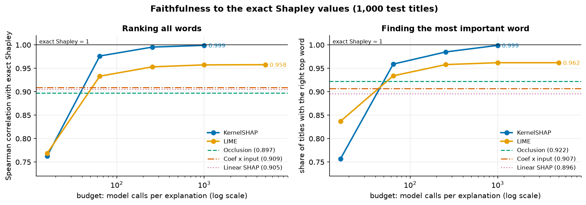
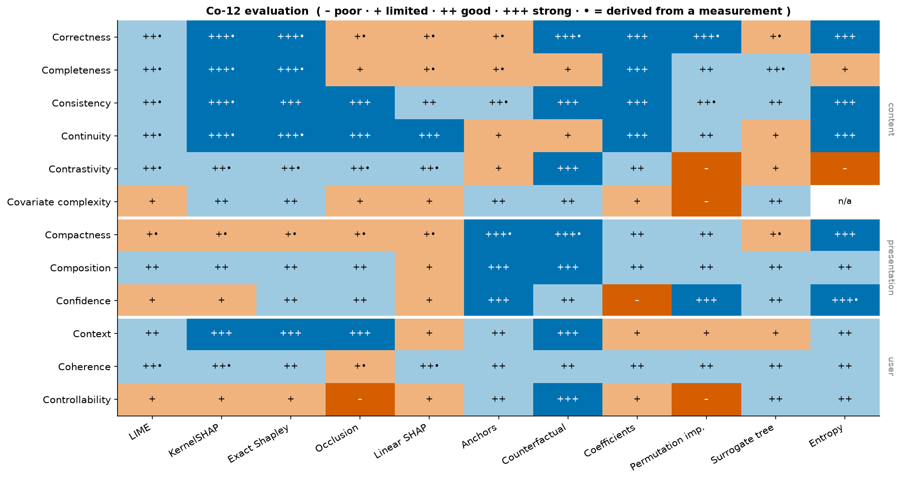

# Do explainers tell the truth? Explainable venue recommendation for paper titles

**Given only a paper's title, which venue should you submit to: INFOCOM, ISCAS, SIGGRAPH,
VLDB or WWW? And can you trust the model's explanation of its recommendation?**

This project explains a TF-IDF + logistic-regression venue recommender (86% accuracy on
DBLP titles) with LIME, SHAP, Anchors, counterfactuals, permutation importance and
surrogate trees. Its main contribution is a test that the usual XAI evaluation cannot run:
because titles are short, we can compute **the exact Shapley value of every word** by
enumerating all subsets of words. That gives a **ground truth** against which each
explainer can be measured, instead of judged on whether it "looks plausible".

<p align="center">
  
</p>

## Key findings

| | Finding |
|---|---|
| 🎯 **Faithfulness** | On 1,000 test titles, **KernelSHAP converges to the exact Shapley values** (rank correlation 0.999 at 1,000 calls). **LIME plateaus at ≈ 0.96** and names the wrong most important word for ≈ 4% of titles, even at its default 5,000 samples. More samples make LIME *more stable*, but not *more correct*. |
| ⚡ **Cost** | For short texts, the exact answer is **cheaper than the approximation**: exact Shapley needs a few hundred model calls (≈ 0.01 s), while default LIME needs 5,000 (≈ 0.5 s). |
| 🐛 **Bugs in the original analysis** | The original LIME/Anchors code skipped the spaCy preprocessing, so it explained a different model: that model **changes the predicted venue for 8.4% of test titles**. The feature-space SHAP plots put **≈ 46% of their attribution on words absent from the title**, which led to a misreading in the original report. |
| ⚓ **Anchors** | Rules are reported with ≥ 0.99 precision on alibi's own perturbation samples. On real test titles that contain the rule's words, the model agrees with the rule only **85%** of the time on average, and 28% of rules hold for fewer than 80% of such titles (e.g. `network → INFOCOM`: **50%**). |
| 🌳 **Surrogates** | The depth-4 surrogate tree the original report presented reproduces the model for only **70%** of test titles and **never** reproduces its SIGGRAPH predictions. |
| 🔍 **Shortcuts** | Explanations exposed a shortcut: every *Front Matter* title is labelled VLDB, so `matter` ranks among the 15 most important features. |
| 📉 **Confidence** | The model is **under**-confident, not over-confident as originally claimed (ECE 0.15 → 0.02 after temperature scaling). Abstaining on the least confident 25% of titles raises accuracy on the rest from 86% to ≥ 95%. |
| 📋 **Co-12** | All 11 methods are rated on all 12 Co-12 properties (Nauta et al., 2023). Every rating that can be measured (40 of 132, mostly the content properties) is derived from a measurement in this repository with fixed thresholds; the remaining ratings are reasoned judgements with stated evidence. |

<p align="center">
  
</p>

## What is in the repository

| Notebook | Question | Highlights |
|---|---|---|
| [01 · Data, model & audit](notebooks/01_data_model_audit.ipynb) | What is being explained, and is the data clean? | train/test label shift, quantified preprocessing bug, *Front Matter* shortcut, duplicates, HTML artefacts |
| [02 · Local explanations](notebooks/02_local_explanations.ipynb) | Why this venue for this title? | exact Shapley vs LIME vs occlusion vs feature-space SHAP, Anchors, minimal-edit counterfactuals |
| [03 · Explainer benchmark](notebooks/03_explainer_benchmark.ipynb) | Do explainers match the ground truth? (RQ1, RQ2) | 1,000 titles, equal-budget convergence, stability over seeds, null-word continuity, disagreement matrix, Anchors on real data |
| [04 · Global explanations](notebooks/04_global_explanations.ipynb) | What has the model learned overall? (RQ3) | coefficients, permutation importance with CIs, agreement between global rankings, surrogate fidelity vs. depth |
| [05 · Confidence & calibration](notebooks/05_confidence_calibration.ipynb) | Can we trust the model's confidence? (RQ4) | reliability diagrams, temperature scaling, label-shift correction, risk–coverage, overconfident errors explained |
| [06 · Co-12 evaluation](notebooks/06_co12_evaluation.ipynb) | How do the methods compare overall? | 11 methods × 12 properties, evidence for every cell |

The full write-up is in **[REPORT.md](REPORT.md)**. A point-by-point response to the
course feedback, and the list of errors corrected from the original submission, is in
**[docs/REVISION_NOTES.md](docs/REVISION_NOTES.md)**.

```
├── data/                       DBLP titles (train / test / ground truth) + data card
├── src/tcner_xai/              shared package used by every notebook
│   ├── data.py                 loading, spaCy preprocessing, data audit
│   ├── model.py                TF-IDF + logistic regression, cached "bundle"
│   ├── explain.py              exact Shapley, LIME, KernelSHAP, linear SHAP, occlusion,
│   │                           Anchors, counterfactuals
│   ├── benchmark.py            per-title ground-truth benchmark
│   ├── metrics.py              agreement, comprehensiveness, sufficiency, compactness
│   ├── calibration.py          ECE, temperature scaling, EM prior shift, risk–coverage
│   └── plotting.py             one colour-blind-safe style for all figures
├── notebooks/                  01–06, executed, with outputs
├── figures/                    every figure used in the README and report
├── results/                    every number in the report, as CSV
├── scripts/run_notebooks.py    re-executes all notebooks in order
└── docs/                       revision notes + the original course submission
```

## Reproduce

```bash
conda create -n xai-tcner python=3.11 -y
```

```bash
conda activate xai-tcner
```

```bash
pip install -r requirements.txt
```

```bash
python -m spacy download en_core_web_sm
```

```bash
python scripts/run_notebooks.py
```

Running everything takes about 10 minutes on a laptop CPU. Seeds are fixed, so the
numbers in `results/` reproduce exactly with the pinned versions. The first notebook caches
the cleaned titles and the fitted model in `artifacts/` (git-ignored).

## Method in one paragraph

Each explanation is computed over the **distinct lemmas of the cleaned title**, which are
exactly the tokens the model sees. Removing a word deletes it before the title is re-vectorised. This
defines a cooperative game *v(S)* = P(venue | only the words in *S*). Its Shapley values are
the ground truth. LIME and KernelSHAP are two estimators that look at samples of the same
game, occlusion uses only its leave-one-out differences, and the original project's SHAP
works in TF-IDF feature space instead. Titles have a median of 7 distinct content words, so
all 2ⁿ subsets can be enumerated. Faithfulness is then a measured error, alongside
stability, continuity, contrastivity, compactness and cost. These measurements feed the
Co-12 ratings.

## Authors and context

**Aleksandar Nikolov** and **Daan Schram**, University of Twente. This started as the group
project for the *Explainable AI* course (2025), building on a title-classification
assignment from the IENLP course. The original report and Co-12 tables are kept in
[`docs/original_submission/`](docs/original_submission/). This repository is a substantially
revised and extended version (v2, 2026).

Data: paper titles from the [dblp computer science bibliography](https://dblp.org) (CC0),
split by the course staff; see [`data/README.md`](data/README.md).

## License

The code, notebooks, figures and write-up are released under the [MIT License](LICENSE).
The DBLP titles in `data/` keep their own terms (see the data card). Dependencies keep their
own licenses; note that `alibi` (used for Anchors) is under the Business Source License.
