# Do Explainers Tell the Truth? A Ground-Truth Evaluation of Local and Global Explanations for Title-Based Venue Recommendation

**Aleksandar Nikolov, Daan Schram** — University of Twente
*Revised and extended edition (v2, 2026) of the group project for the Explainable AI course (2025).*

---

## Abstract

Researchers choose where to submit a paper long before they have reviews, and a venue
mismatch costs months. A venue recommender is useful only if authors can tell whether its
suggestion rests on the substance of the paper or on incidental wording, so its
explanations must be *faithful*. Faithfulness, however, is usually judged by eye: post-hoc
explainers such as LIME and SHAP are rarely checked against a ground truth, and they often
disagree. We study a TF-IDF + logistic-regression classifier that recommends one of five
computer-science venues from a paper title (86.2% accuracy, 95.6% top-2 accuracy on DBLP).
Titles are short — a median of seven distinct content words — so the **exact Shapley values
of every word can be computed by enumeration**. We use them as ground truth to evaluate
LIME, KernelSHAP, occlusion and feature-space SHAP on 1,000 test titles. KernelSHAP
converges to the ground truth; LIME plateaus at a rank correlation of ≈ 0.96 and picks the
wrong most important word for ≈ 4% of titles even at its default budget, while
being more stable than it is correct. For these short inputs, computing the exact answer
is cheaper than running LIME. We also show that Anchors' reported precision does not hold
on real titles, that a readable surrogate tree reproduces the model on only 70% of titles,
that the model is under-confident (and can be fixed with temperature scaling), and
that global explanations expose a data shortcut. We rate eleven methods on all twelve Co-12
properties, deriving every rating that can be measured from the experiments. Re-running the
original course analysis also revealed several errors, which we correct and document.

---

## 1. Introduction

### 1.1 The problem: where should this paper go?

Choosing a venue is a recurring decision for every researcher, and a poor choice is costly:
papers are often rejected not for their quality but because they fall outside a venue's
scope (Pradhan & Pal, 2019). This motivated a line of *venue recommenders* that suggest
conferences or journals from a paper's content (Yang & Davison, 2012; Pradhan & Pal, 2019;
Kobs et al., 2020). Kobs et al. (2020) already argue that such a system should be
*interpretable* and attach word-level attributions (Integrated Gradients) to each
recommendation.

We study the simplest version of the task: given **only the title** of a computer-science
paper, recommend one of five venues — INFOCOM (networking), ISCAS (circuits & systems),
SIGGRAPH (graphics), VLDB (databases) and WWW (the Web). The data are 21,643 training and
3,373 test titles from DBLP.

### 1.2 Why explanations matter here

Explanations serve two audiences in this application:

1. **The author** who receives a recommendation must decide whether to act on it. *“VLDB,
   because of the word ‘database’”* invites a different response than *“VLDB, because
   of the word ‘matter’”*. An explanation is only useful to the author if it is
   **faithful**, i.e. it reflects what the model actually did (Jacovi & Goldberg, 2020).
2. **The developer** uses explanations to debug the model and the data. Text classifiers
   are prone to *shortcut learning* (Geirhos et al., 2020), where a model exploits
   artefacts that predict the label without carrying topical meaning. In Section 6 we show
   one such shortcut in this dataset.

### 1.3 The research gap: explanations are rarely checked against a ground truth

The XAI literature has many explainers but few ways to verify them. In a review of more
than 300 XAI papers, Nauta et al. (2023) found that one in three evaluates its explanations
*only* with anecdotal evidence. They propose twelve conceptual properties (**Co-12**) to
make evaluation systematic. Krishna et al. (2022) show that popular explainers frequently
**disagree** with each other, and that practitioners resolve the disagreements ad hoc.
Without a ground truth, there is no principled way to decide which explainer is right.

Our setting provides that ground truth. The model is cheap to query and titles are short,
so for each title we can enumerate *every* subset of its words and compute the **exact
Shapley values** (Shapley, 1953; Štrumbelj & Kononenko, 2014) of the word-removal game that
LIME and KernelSHAP try to approximate. Faithfulness then becomes a measured error rather
than a judgement. The model is linear, which makes this a *best case* for post-hoc
explainers: any failure we measure here should be expected to be at least as large for
black-box models.

### 1.4 Research questions

* **RQ1 — Faithfulness.** When the true word contributions are known exactly, how close do
  LIME, KernelSHAP, occlusion and feature-space SHAP get, and at what cost in model calls?
* **RQ2 — Robustness and agreement.** Are explanations stable across random seeds and under
  edits the model provably ignores, and how much do explainers disagree?
* **RQ3 — Debugging.** Do global explanations expose shortcuts or artefacts in the data?
* **RQ4 — Trust in confidence.** Is the model's confidence calibrated, and can an
  uncertainty-aware recommender abstain to make its answers more reliable?

Finally, we rate every method on all twelve Co-12 properties, using the measurements from
RQ1–RQ4 wherever possible.

### 1.5 Contributions

1. An **exact word-level Shapley ground truth** for short-text classification, and a
   benchmark of five attribution methods against it at equal model-call budgets (1,000
   titles).
2. Quantitative tests of **stability, continuity (a null-word test), contrastivity,
   completeness and compactness**, plus a re-evaluation of **Anchors on real data**.
3. A **complete Co-12 evaluation** (11 methods × 12 properties) with the evidence for each rating.
4. A **calibration and selective-prediction** analysis that turns confidence into a product
   feature (answer, or offer a shortlist).
5. A **corrected and reproducible** version of the original course analysis, with the
   errors found documented in [`docs/REVISION_NOTES.md`](docs/REVISION_NOTES.md).

---

## 2. Related work

**Venue recommendation.** Yang & Davison (2012) recommend venues with collaborative
filtering over topic and writing-style features; CNAVER (Pradhan & Pal, 2019) fuses
content and citation-network signals on DBLP; *Where to Submit?* (Kobs et al., 2020)
uses a TextCNN over title, abstract and keywords and explains it with Integrated
Gradients. Classical bag-of-words classifiers remain strong baselines for short texts
(Sebastiani, 2002).

**Local explanations.** LIME (Ribeiro et al., 2016) fits a weighted sparse linear model to
perturbations around an instance; SHAP (Lundberg & Lee, 2017) attributes a prediction with
Shapley values, estimated model-agnostically by KernelSHAP or in closed form for linear
models; Anchors (Ribeiro et al., 2018) find if-then rules that are sufficient for a
prediction with high precision; counterfactual explanations (Wachter et al., 2018) give the
smallest change that would alter the decision. Garreau & von Luxburg (2020) and Mardaoui &
Garreau (2021) analyse LIME theoretically and show that for linear models on text its
weights are meaningful but not equal to the model's own contributions — a prediction we test
empirically.

**Global explanations.** Permutation importance (Breiman, 2001) measures how much a model
relies on a feature; global surrogates (Craven & Shavlik, 1996) approximate a model with an
interpretable one and must be judged by their *fidelity*.

**Evaluating explanations.** Co-12 (Nauta et al., 2023) groups evaluation into content
(Correctness, Completeness, Consistency, Continuity, Contrastivity, Covariate complexity),
presentation (Compactness, Composition, Confidence) and user (Context, Coherence,
Controllability) properties. ERASER (DeYoung et al., 2020) measures faithfulness by
*comprehensiveness* and *sufficiency* (deleting or keeping the highlighted words);
Jacovi & Goldberg (2020) argue that faithfulness and plausibility must be evaluated
separately; Alvarez-Melis & Jaakkola (2018) show that explanations are often unstable
under small input changes; Krishna et al. (2022) document the disagreement problem.

**Confidence.** Modern classifiers are often miscalibrated; temperature scaling is a simple,
effective fix (Guo et al., 2017), measured with the expected calibration error (ECE; Naeini
et al., 2015). When class priors shift between training and deployment, posteriors can be
re-weighted by EM (Saerens et al., 2002). Selective classification lets a model abstain on
uncertain inputs to trade coverage for accuracy (Geifman & El-Yaniv, 2017).

---

## 3. Data and model

### 3.1 Data

| | train | test |
|---|---|---|
| titles | 21,643 (21,497 after removing exact duplicates) | 3,373 |
| ISCAS / INFOCOM / VLDB / WWW / SIGGRAPH | 35% / 21% / 17% / 15% / 12% | **61%** / 15% / 6% / 13% / 6% |

The venue mix differs strongly between the splits (label shift; Figure 1). An audit
(notebook 01) also found:

* **boilerplate titles** such as *Front Matter* (17 in train, 12 in test, all VLDB),
  *Letter from the associate editors*, *Reviewers list* and *Keynote talk* (47 in train);
* the only titles shared between train and test are those 12 *Front Matter* entries;
  2 training titles carry conflicting labels;
* **HTML markup** in 121 training and 24 test titles (e.g. `<i>Elysium</i>`), which the
  original preprocessing turns into tokens such as `elysium</i`.

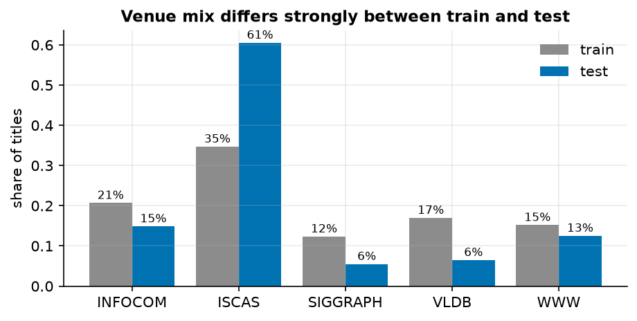 <em>Figure 1 — The test set is dominated by ISCAS.</em>

### 3.2 Model

Unchanged from the original submission, so that the explanations remain comparable: spaCy
`en_core_web_sm` lower-casing, lemmatisation, and removal of stop words, punctuation and
tokens of ≤ 2 characters → TF-IDF over 5,000 uni- and bigrams (`min_df=3`, `max_df=0.85`)
→ one-vs-rest logistic regression (liblinear).

| accuracy | top-2 accuracy | top-3 accuracy | macro F1 | weighted F1 |
|---|---|---|---|---|
| 0.862 | 0.956 | 0.982 | 0.778 | 0.862 |

Most errors are between topically overlapping venues (VLDB ↔ WWW, 12% each way) or towards
the dominant class ISCAS (20% of SIGGRAPH titles).

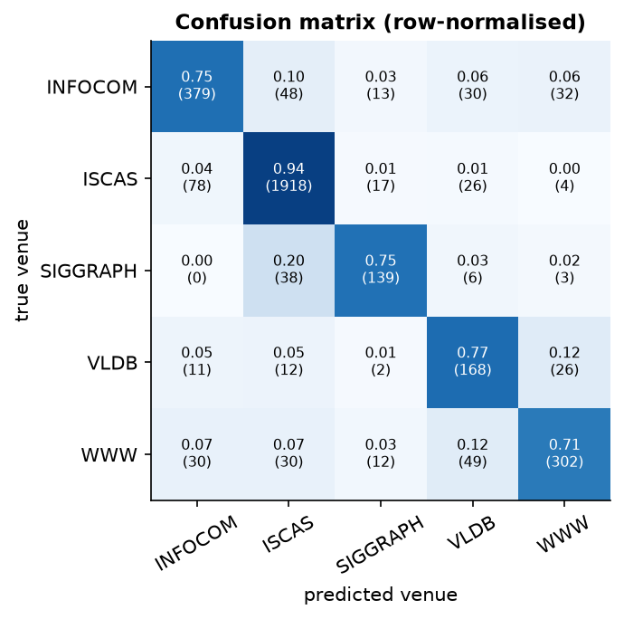 <em>Figure 2 — Row-normalised confusion matrix on the test set.</em>

### 3.3 A correction: explaining the model that is actually evaluated

The original notebook passed **raw** titles to the vectoriser for LIME and Anchors and
skipped the spaCy preprocessing. That input path is a different function: it **changes the
predicted venue for 283 of 3,373 test titles (8.4%)** and has an accuracy of 82.8% instead
of 86.2%. In this version every explainer calls the same prediction function as the
evaluation, either on cleaned text or on raw text passed through the same spaCy pipeline.

---

## 4. Method

### 4.1 Interpretable features and the removal game

All word-level methods explain the model over the **distinct lemmas of the cleaned title**:
the exact tokens the model sees. Stop words are removed by the preprocessing, so they
cannot affect the prediction and do not need to be explained. *Removing* a word deletes
all of its occurrences before re-vectorising. For a title with word set *N* and venue
*k*, this defines the game

$$v_k(S) = P\big(k \mid \text{title restricted to the words in } S\big), \qquad S \subseteq N.$$

Its Shapley values

$$\phi_i = \sum_{S \subseteq N\setminus\{i\}} \frac{|S|!\,(n-|S|-1)!}{n!}\,\big(v_k(S\cup\{i\}) - v_k(S)\big)$$

are the unique attribution that is efficient (they sum to $v_k(N) - v_k(\varnothing)$),
symmetric, and gives zero to words that never matter. We compute them **exactly** by
evaluating all $2^n$ subsets in one vectorised batch (≤ 32,768 model calls for 15 words).
They account for the bigram interactions and the TF-IDF normalisation that couple the
words. The same enumeration gives the exact values in log-odds space, which are the
reference for the feature-space methods.

### 4.2 Explanation methods

| | method | configuration | rationale |
|---|---|---|---|
| local | **Exact Shapley** | full enumeration | ground truth of the removal game |
| local | **KernelSHAP** | 16 – 1,000 samples, zero background (= word removed) | model-agnostic estimator of the same Shapley values |
| local | **LIME** | 16 – 5,000 samples, `bow=True`, kernel width 25 | the most widely used local explainer; same perturbations |
| local | **Occlusion** | leave-one-out, n + 1 calls | the cheapest baseline |
| local | **Linear SHAP** (original) | $\phi_j = w_{kj}(x_j-\bar x_j)$ in TF-IDF space, mapped to words | what the original project used |
| local | **Coefficient × input** | $w_{kj}x_j$ in TF-IDF space, mapped to words | gradient × input analogue |
| local | **Anchors** | alibi `AnchorText`, UNK sampling, threshold 0.95 | rule-based sufficiency |
| local | **Counterfactuals** | exhaustive minimal word deletions (≤ 3); best single-word insertion | contrastive, actionable for authors |
| global | **Coefficients** | top ± terms per venue | exact global description of a linear model |
| global | **Permutation importance** | all 5,000 features, 30 repeats, exact fast implementation | reliance of accuracy on each term |
| global | **Surrogate tree** | depth 1 – unlimited, fit on model predictions | readable approximation, judged by fidelity |
| confidence | **Entropy / calibration** | normalised entropy, ECE, temperature scaling, EM prior shift | is the confidence trustworthy? |

### 4.3 Evaluation measures

* **Faithfulness to the ground truth:** Spearman rank correlation with the exact Shapley
  values; *top-1 match* (same most important word); *top-3 agreement* and *sign agreement*
  (Krishna et al., 2022).
* **Removal-based faithfulness:** comprehensiveness (drop in P(predicted venue) after
  deleting the top-k words) and sufficiency (drop when keeping only the top word) (DeYoung
  et al., 2020), compared with a random ranking.
* **Consistency:** mean pairwise top-3 Jaccard and Spearman over five random seeds, at equal
  budgets (64 and 1,000 calls) for LIME and KernelSHAP.
* **Continuity (null-word test):** insert the stop word *“the”* at a random position. The
  vectoriser drops it, so the prediction is bit-for-bit identical. A continuous explainer
  should keep its ranking and give the new word zero weight.
* **Contrastivity:** rank correlation between the explanation for the predicted venue and
  for the runner-up venue.
* **Completeness:** efficiency gap (|Σφ − (v(N) − v(∅))|), LIME's local R², the share of
  feature-space attribution on absent n-grams, Anchor coverage, surrogate fidelity.
* **Compactness:** number of words that carry 80% of the absolute attribution; rule length.
* **Cost:** model calls and wall-clock time per explanation.
* **Calibration:** ECE (15 bins), NLL, Brier score, reliability diagrams; selective
  prediction by risk–coverage curves and AURC.

The benchmark uses 1,000 test titles with 2 – 14 distinct words, sampled with a fixed seed
(≈ 99% of the test set is eligible). Temperature scaling is fitted on 5-fold out-of-fold
predictions for the *training* titles, so the test set is used only for evaluation.

---

## 5. Results: local explanations

### 5.1 Case studies

Figure 3 explains six test titles with four attribution methods, including the titles
discussed in the original report.

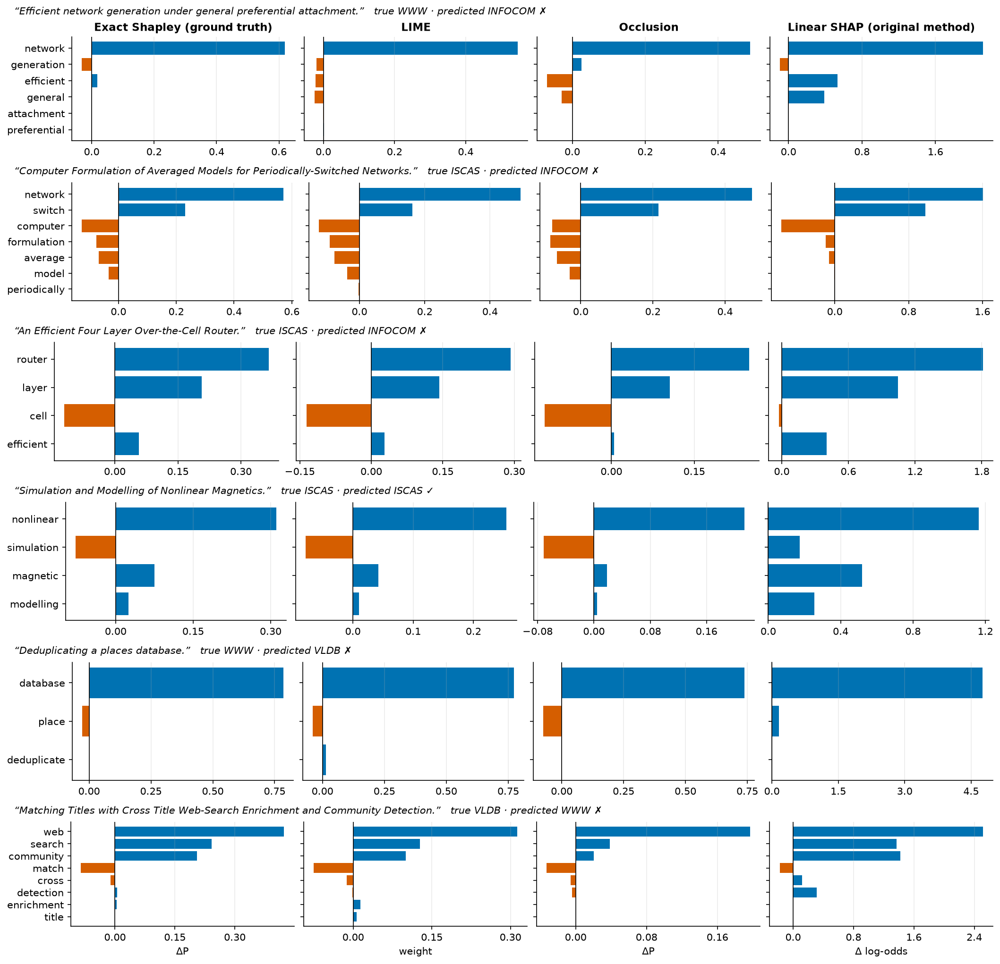 <em>Figure 3 — Exact Shapley (ground truth), LIME, occlusion and feature-space SHAP for the predicted venue. Blue supports the predicted venue, orange opposes it.</em>

On these titles the methods agree on the dominant word (*network*, *router*, *nonlinear*,
*database*, *web*), but not always on the rest. For *Efficient network generation under
general preferential attachment*, the exact Shapley value of *efficient* is positive
while LIME and occlusion make it negative. Feature-space SHAP, the method of the original
project, assigns a large positive weight to *general* (+0.4 log-odds), which the exact
values give no weight at all.

**Feature-space SHAP explains missing words.** For a linear model, SHAP's linear explainer
returns $\phi_j = w_{kj}(x_j - \bar x_j)$ for *all* 5,000 n-grams, including the ones absent
from the title ($x_j = 0$). We verified that our closed form matches `shap.LinearExplainer`
exactly. On the case titles, 24–59% of the absolute attribution sits on absent n-grams, 46% on
average over the benchmark. For the *network generation* title, the largest absent-word
contributions are `web` (+0.07), `wireless` (−0.06) and `database` (+0.05). The original
report read the force plot as “*web* … more associated with the true label WWW”, but *web*
does not occur in that title: the plot showed the effect of its *absence*.

**Contrastive explanations and counterfactuals.** Figure 4 shows the exact attributions for
the predicted *and* the true venue, together with the smallest edit that would change the
recommendation. *An Efficient Four Layer Over-the-Cell Router* is called INFOCOM because of
*router*; deleting that single word makes it ISCAS, and so would adding *circuit*. For
*Computer Formulation of Averaged Models for Periodically-Switched Networks* the minimal
deletion is {*computer*, *network*}, or adding *chip*. When no edit of up to three
deletions reaches the true venue (*Deduplicating a places database*: VLDB instead of WWW),
that fact is itself informative: the title contains no WWW evidence at all.

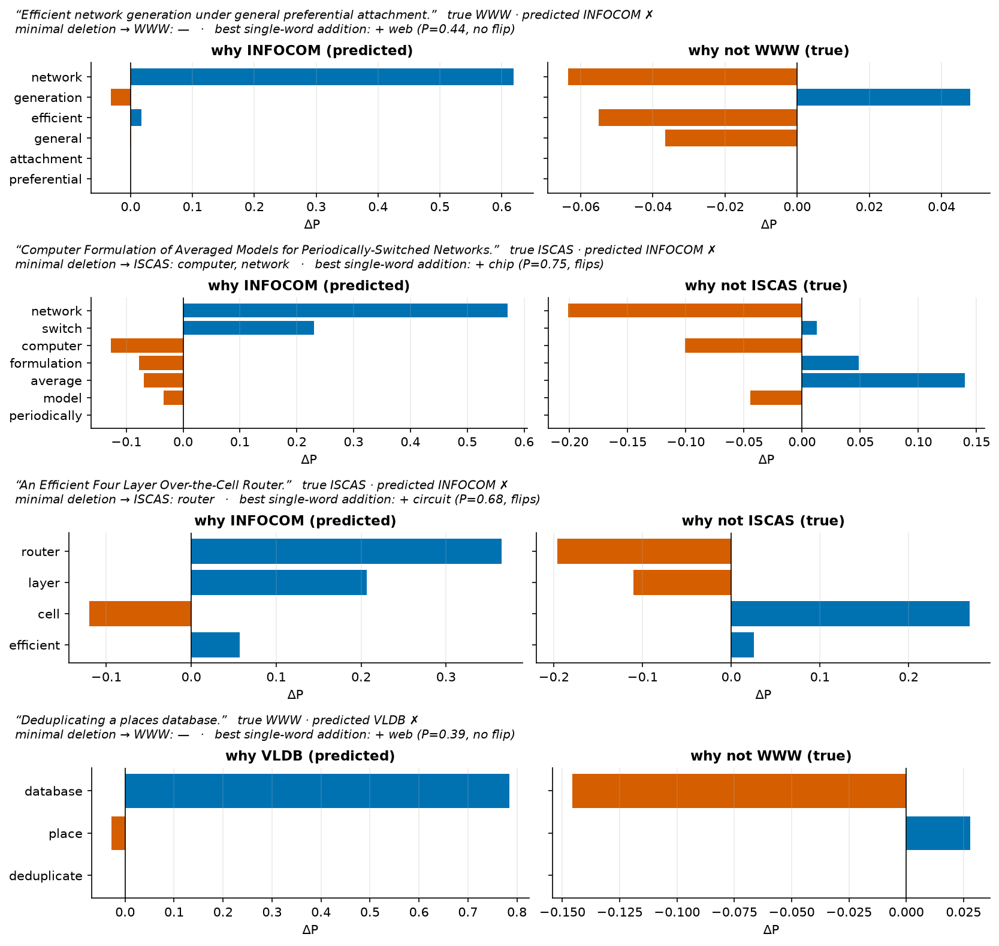 <em>Figure 4 — Why the predicted venue, why not the true one, and the minimal edit that would change the decision.</em>

### 5.2 RQ1 — Faithfulness to the exact Shapley values

Table 1 and Figure 5 summarise the benchmark on 1,000 test titles (14.5% of them
misclassified).

*Table 1 — Agreement with the exact Shapley values (mean over 1,000 titles). Spearman = rank
correlation over all words; top-1 = same most important word; top-3 = share of the top-3 words
in common; comp@1 = drop in P(predicted venue) after deleting the top-ranked word. Seconds are
wall-clock times on a laptop CPU and vary slightly between runs.*

| method | budget | Spearman | top-1 | top-3 | comp@1 | mean calls | seconds |
|---|---|---|---|---|---|---|---|
| Exact Shapley | all 2ⁿ subsets | 1.000 | 1.000 | 1.000 | 0.190 | 392 | 0.013 |
| KernelSHAP | 64 | 0.976 | 0.959 | 0.965 | 0.190 | 54 | 0.009 |
| KernelSHAP | 1,000 | 0.999 | 0.999 | 0.999 | 0.190 | 256 | 0.020 |
| LIME | 64 | 0.933 | 0.934 | 0.899 | 0.191 | 64 | 0.053 |
| LIME | 1,000 | 0.957 | 0.962 | 0.922 | 0.191 | 1,000 | 0.135 |
| LIME | 5,000 (default) | 0.958 | 0.962 | 0.923 | 0.191 | 5,000 | 0.482 |
| Occlusion | n + 1 | 0.897 | 0.922 | 0.856 | 0.192 | 8 | 0.001 |
| Linear SHAP (original) | closed form | 0.905 | 0.896 | 0.838 | 0.189 | — | 0.004 |
| Coefficient × input | closed form | 0.909 | 0.907 | 0.841 | 0.189 | — | 0.002 |
| Random | — | 0.013 | 0.161 | 0.486 | 0.035 | — | 0.000 |

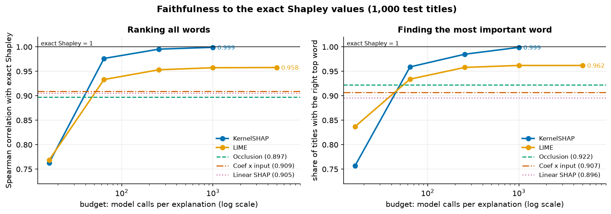 <em>Figure 5 — KernelSHAP converges to the exact values as the budget grows; LIME levels off below them.</em>

* **KernelSHAP converges to the truth.** Its rank correlation rises from 0.76 (16 calls) to
  0.976 (64), 0.995 (256) and 0.999 (1,000), where it finds the right top word for 99.9% of titles.
* **LIME plateaus.** At very small budgets it is as good as KernelSHAP, but above 256 calls
  more samples no longer help: its rank correlation stays at 0.958 and it names the **wrong top
  word for 3.8% of titles** at its default 5,000 samples. Its weights also do not add up to the
  prediction: the efficiency gap is 0.17 probability points on average.
* **Occlusion and the TF-IDF-space methods** reach a rank correlation of ≈ 0.90–0.91 and get
  the top word wrong for 8–10% of titles. Occlusion needs only n + 1 calls.
* **The exact answer is cheaper than LIME.** Exact Shapley took on average 392 model calls
  and about 0.01 s per title, compared with 5,000 calls and about 0.5 s for default LIME (roughly 35–40× slower).
* **Deletion metrics cannot tell the methods apart** (Figure 6). Deleting the top-ranked word
  lowers P(predicted venue) by 0.19 for *every* method (random ranking: 0.04), because all of
  them usually identify the dominant word. The differences lie further down the ranking,
  where only a ground truth can detect them.

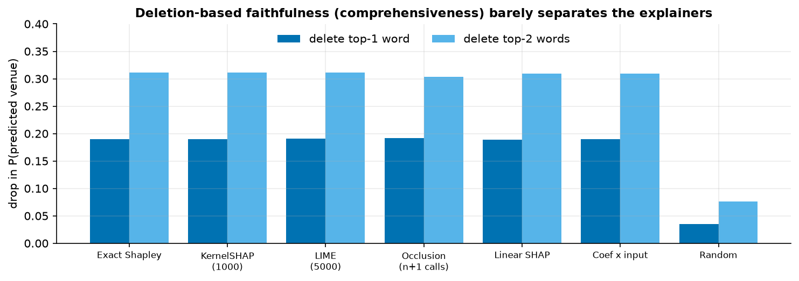 <em>Figure 6 — ERASER-style comprehensiveness is nearly identical across methods.</em>

### 5.3 RQ2 — Stability, continuity and disagreement

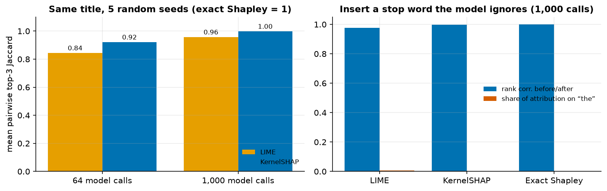 <em>Figure 7 — Left: repeatability over five seeds at equal budgets. Right: inserting a stop word that the model provably ignores.</em>

* **Seeds.** At 64 calls, LIME's top-3 words overlap 0.84 (Jaccard) across seeds and
  KernelSHAP's 0.92; at 1,000 calls they reach 0.96 and 0.997. LIME is therefore **stable but
  not faithful**: at 1,000 calls it repeats itself, but it repeats the same deviation from
  the truth.
* **Null-word continuity.** Inserting *“the”* leaves the prediction bit-for-bit unchanged.
  Exact Shapley gives the new word exactly 0 and keeps all other scores (rank correlation
  1.000). KernelSHAP: 0.997 rank correlation with 0.1% of attribution on the null word; LIME:
  0.976 and 0.7%.
* **Disagreement.** Figure 8 shows the mean pairwise rank correlation between methods. The
  two feature-space methods agree with each other almost perfectly (0.998, they are nearly
  the same formula), yet each agrees with the truth at only ≈ 0.91. Occlusion agrees more with
  LIME (0.94) than with the truth (0.91). Agreement between two explainers is therefore not
  evidence that either is correct. When explainers disagree here, the ground truth settles it
  in favour of KernelSHAP.

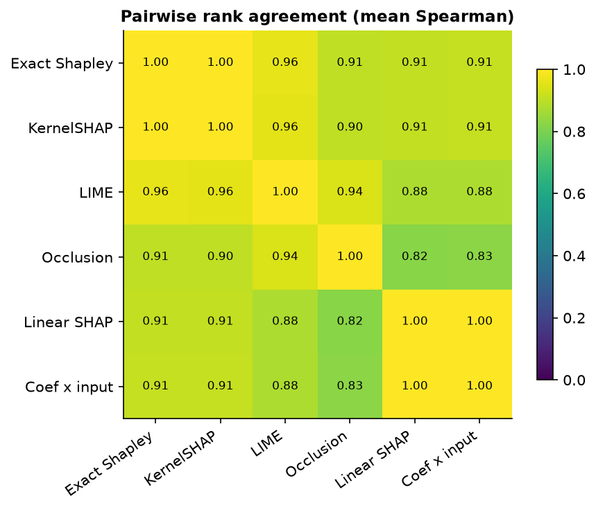 <em>Figure 8 — Mean pairwise Spearman correlation between explanation methods (300 titles).</em>

### 5.4 Anchors on real data

We ran alibi's `AnchorText` on 60 benchmark titles with three seeds.

* **28% of the anchors are empty**, all for titles predicted as ISCAS: no word is needed,
  because ISCAS is what the model predicts when a title contains no evidence for any other
  venue. That is a real property of the model, but an empty rule explains nothing to an author.
* The non-empty rules are short (1.2 words on average) and alibi reports a precision of
  **0.999** for them. The precision is also ≥ 0.99 under our word-removal perturbation.
* On **real test titles that contain the rule's words**, however, the model assigns the
  rule's venue only **0.85** of the time on average (median 0.97); **28% of the rules hold
  for fewer than 80%** of such titles. Examples: `bandwidth → INFOCOM` holds for 31% of
  test titles containing *bandwidth*, and `network → INFOCOM` for 50%. Rules apply to
  2.3% of test titles on average. alibi's reported "coverage" (≈ 0.45) is measured on its own
  perturbation samples and says nothing about real titles.
* The rule contains the word with the largest exact Shapley value in 74% of cases, and the
  same rule is found under all three seeds for 90% of titles.

The precision an anchor promises is conditional on alibi's perturbation distribution, not
on the population of titles an author might write.

---

## 6. Results: global explanations and confidence

### 6.1 RQ3 — What the model learned, and a shortcut

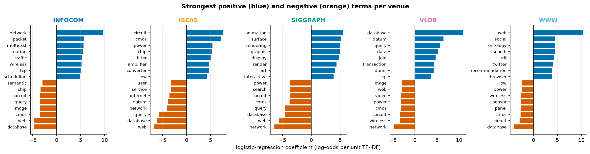 <em>Figure 9 — Strongest positive and negative terms per venue.</em>

The coefficients (Figure 9) are coherent with the venues' topics: *network, packet,
routing, wireless* → INFOCOM; *circuit, cmos, amplifier, filter* → ISCAS; *rendering,
animation, graphic* → SIGGRAPH; *database, query* → VLDB; *web, social, search, ontology* →
WWW.

**Permutation importance exposes artefacts** (Figure 10). With all 5,000 features, all test
titles and 30 repeats (made affordable by an exact incremental computation for linear
models), two of the 15 most important terms are not topical at all. **`matter`** comes only
from the boilerplate title *Front Matter*: all 17 training and all 12 test copies are labelled
VLDB, so the model "correctly" classifies them by shortcut (Geirhos et al., 2020).
**`datum`** is spaCy's lemma of *data*. Removing boilerplate from training leaves accuracy
unchanged (0.8615 → 0.8615 on the full test set): the shortcut is real but affects only a
small share of titles.

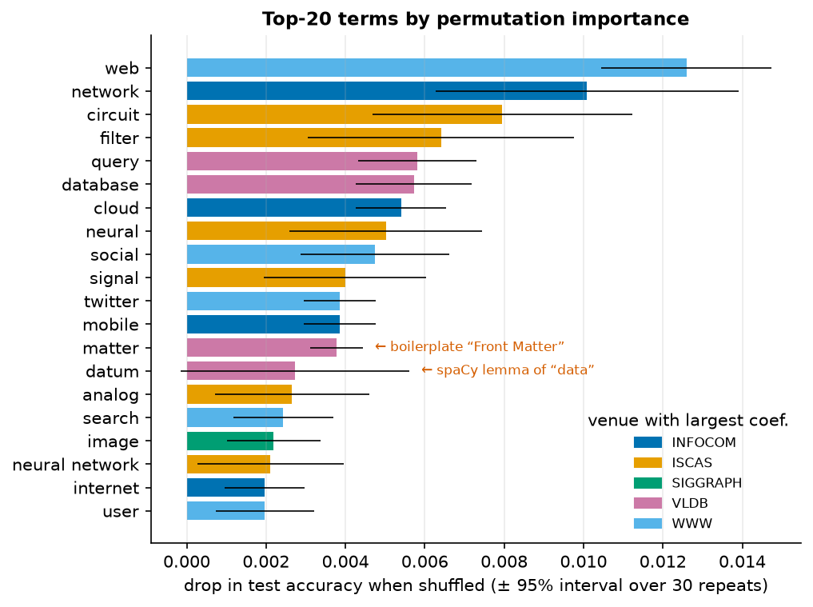 <em>Figure 10 — Top-20 terms by permutation importance with 95% intervals; colour = venue with the largest coefficient.</em>

**Global methods disagree.** Permutation importance, the largest absolute coefficient and
the mean absolute contribution |w·x| rank the vocabulary differently (Spearman 0.24–0.52;
top-20 overlap 35–55%). *packet* and *routing* are in the top 10 by coefficient but not in the
top 50 by permutation importance, because they occur rarely. "Most important word" is not
one well-defined quantity.

**Surrogate trees are readable but not faithful** (Figure 11). A depth-4 tree (15 leaves)
reproduces the model's prediction for **69.9%** of test titles and for **none** of its SIGGRAPH
predictions (INFOCOM: 41%, VLDB: 22%, WWW: 26%, ISCAS: 98%). Fidelity grows slowly with size;
even an unlimited tree with 2,685 leaves reaches only 82.8%.

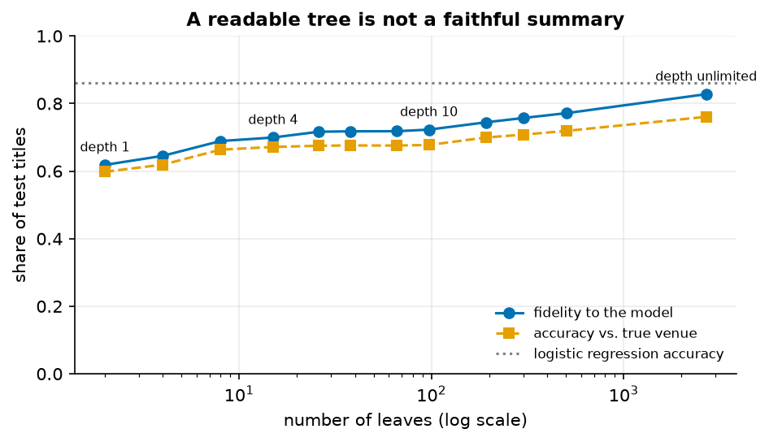 <em>Figure 11 — Fidelity of surrogate trees to the model as a function of their size.</em>

### 6.2 RQ4 — Can the model's confidence be trusted?

*Table 2 — Calibration on the test set. Temperature fitted on out-of-fold training predictions; EM uses unlabelled test titles.*

| variant | accuracy | macro F1 | ECE | NLL | Brier | mean confidence |
|---|---|---|---|---|---|---|
| original | 0.862 | 0.778 | 0.153 | 0.514 | 0.240 | 0.708 |
| temperature scaled | 0.862 | 0.778 | 0.020 | 0.413 | 0.204 | 0.858 |
| prior-shift corrected (EM) | 0.823 | 0.681 | 0.033 | 0.483 | 0.246 | 0.793 |
| temperature + prior shift | 0.856 | 0.764 | 0.032 | 0.416 | 0.210 | 0.882 |

* **The model is under-confident.** Its mean confidence (0.71) is far below its accuracy
  (0.86): ECE = 0.153, and the reliability curve lies *above* the diagonal (Figure 12). A
  likely cause is the one-vs-rest output: five independent sigmoids renormalised to sum to
  one spread the probability mass too thinly.
* **Temperature scaling fixes it.** A single temperature T = 0.60 fitted on training folds
  lowers the ECE on the untouched test set to **0.020** and the NLL from 0.51 to 0.41, without
  changing any prediction.
* **Label-shift correction does not help.** EM re-estimates the test venue mix reasonably
  (ISCAS 65% vs. a true 61%) but lowers accuracy to 82.3%, because EM assumes calibrated
  posteriors. Even after temperature scaling it does not beat temperature scaling alone.
* **Confident mistakes are rare and understandable.** Entropy separates correct from wrong
  predictions with AUROC 0.82. The most confident errors (e.g. *Deduplicating a places
  database*, VLDB instead of WWW, P = 0.92) are driven by words that genuinely belong to the
  predicted venue (*database* +0.78).

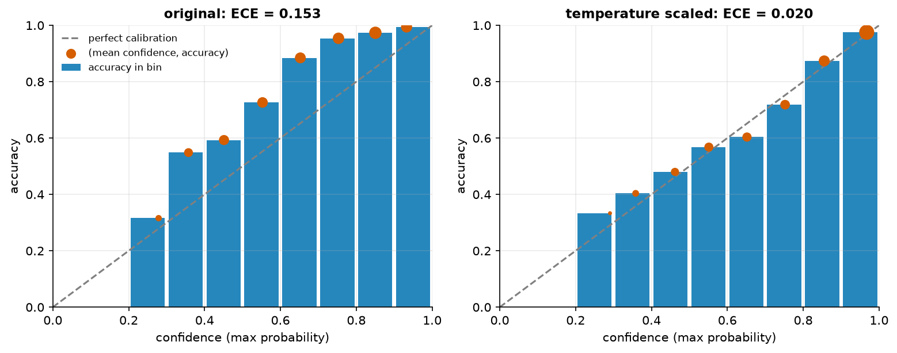 <em>Figure 12 — Reliability before and after temperature scaling.</em>

**Selective prediction** (Figure 13). Ranking titles by calibrated confidence, the
recommender can answer **75%** of titles with ≥ 95% accuracy and **48%** with ≥ 98%.
For the remaining titles it can offer a top-2 shortlist, which contains the correct venue
for 95.6% of all titles.

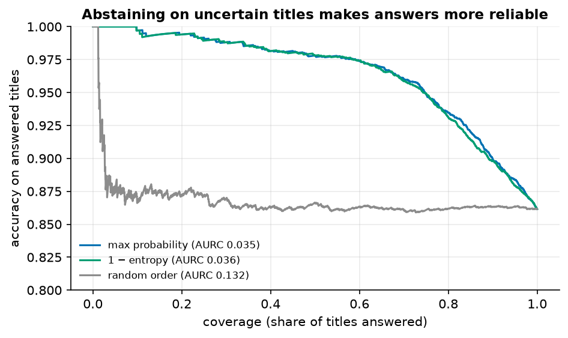 <em>Figure 13 — Accuracy on answered titles as the recommender abstains on the least confident ones.</em>

### 6.3 Co-12 evaluation

Table 3 rates all eleven methods on all twelve Co-12 properties. A dot (•) marks the 40
ratings derived from a measurement in this repository. Their cut points are fixed in
notebook 06; because every attribution method reaches a rank correlation of at least 0.9 on
this linear model, "+++" for Correctness requires ≥ 0.99. The other ratings are reasoned
judgements. The evidence for every cell is in
[`results/co12_evidence.csv`](results/co12_evidence.csv).

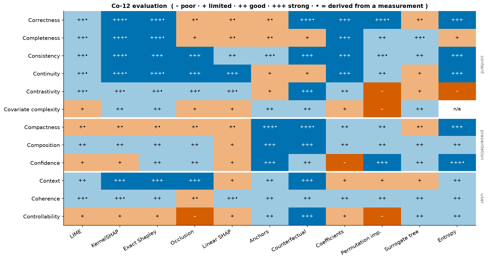

*Table 3 — Co-12 ratings (– poor, + limited, ++ good, +++ strong; • = measured).*

| property | LIME | KernelSHAP | Exact Shapley | Occlusion | Linear SHAP | Anchors | Counterfactual | Coefficients | Permutation imp. | Surrogate tree | Entropy |
|---|---|---|---|---|---|---|---|---|---|---|---|
| Correctness | ++• | +++• | +++• | +• | +• | +• | +++• | +++ | +++• | +• | +++ |
| Completeness | ++• | +++• | +++• | + | +• | +• | + | +++ | ++ | ++• | + |
| Consistency | ++• | +++• | +++ | +++ | ++ | ++• | +++ | +++ | ++• | ++ | +++ |
| Continuity | ++• | +++• | +++• | +++ | +++ | + | + | +++ | ++ | + | +++ |
| Contrastivity | ++• | ++• | ++• | ++• | ++• | + | +++ | ++ | – | + | – |
| Covariate complexity | + | ++ | ++ | + | + | ++ | ++ | + | – | ++ | n/a |
| Compactness | +• | +• | +• | +• | +• | +++• | +++• | ++ | ++ | +• | +++ |
| Composition | ++ | ++ | ++ | ++ | + | +++ | +++ | ++ | ++ | ++ | ++ |
| Confidence | + | + | ++ | ++ | + | +++ | ++ | – | +++ | ++ | +++• |
| Context | ++ | +++ | +++ | +++ | + | ++ | +++ | + | + | + | ++ |
| Coherence | ++• | ++• | ++ | +• | ++• | ++ | ++ | ++ | ++ | ++ | ++ |
| Controllability | + | + | + | – | + | ++ | +++ | + | – | ++ | ++ |

No method is best on every property, so no single explainer should be trusted on its own.
Exact Shapley values over title words dominate the attribution methods on the *content*
properties, and KernelSHAP matches them at its default budget. LIME, the most widely used
explainer, is less correct, less complete and less stable than KernelSHAP; occlusion and the
original feature-space SHAP are cheaper but less correct still. Anchors look excellent on
*presentation* (short rules with a stated precision) but drop on Correctness once their
precision is checked on real titles. Counterfactuals score highest on the *user* properties
(Context, Contrastivity, Controllability). Coefficients, permutation importance and
surrogates serve the developer rather than the author. The feature-space SHAP of the original
project scores low on Completeness and Context because so much of its attribution is about
absent words.

---

## 7. Discussion

### 7.1 Answers to the research questions

**RQ1 — Faithfulness.** With a ground truth available, the explainers can be ranked
objectively. KernelSHAP estimates the exact quantity and converges to it. LIME estimates a
*different* quantity, the weights of a kernel-weighted linear fit, which agrees with the
Shapley ranking on the dominant word but not on the rest of the title. This matches the
theoretical analysis of LIME for linear text models (Mardaoui & Garreau, 2021), and we can
now measure the size of the gap. Occlusion and feature-space SHAP are good, cheap
approximations that still get the most important word wrong for roughly one title in ten.
Removal-based metrics (comprehensiveness) barely separate the methods because they only
test the top word, which almost every method gets right; a ground truth also exposes
errors further down the ranking.

**RQ2 — Robustness and agreement.** The explainers that rely on random sampling become
stable with enough samples. Stability, however, is not faithfulness: LIME at 1,000 calls
repeats itself across seeds but stays consistently away from the truth. In the
null-word test, the methods that estimate Shapley values give an ignored word (almost) no
weight, while LIME's ranking shifts slightly. The disagreement problem (Krishna et al.,
2022) is visible here too, and the ground truth resolves it: when LIME and KernelSHAP
disagree on these titles, KernelSHAP is right.

**RQ3 — Debugging.** Global explanations were useful less for confirming domain knowledge,
which coefficients do trivially, than for finding problems: `matter` (*Front Matter* → VLDB)
and `datum` (a lemmatisation artefact) rank among the most important terms. The global
methods also disagree with each other, because "importance" can mean influence per
occurrence (coefficients) or reliance (permutation importance). A shallow surrogate tree
looks like a summary of the model but reproduces only 70% of its predictions; its fidelity
has to be reported next to the tree.

**RQ4 — Confidence.** The model's probabilities are too *low* rather than too high, and a
single temperature fitted on training folds fixes most of the miscalibration. The original
report's "overconfidence" conclusion came from listing confident mistakes, which is
exactly the anecdotal evaluation Co-12 warns against. Once calibrated, confidence becomes
actionable: the recommender can answer the 75% of titles it is most sure about with ≥ 95%
accuracy and offer a top-2 shortlist for the rest.

### 7.2 Recommendations for an explainable venue recommender

1. Explain **the words the user can see**, with exact Shapley values when inputs are short
   (they are cheaper and exact), or KernelSHAP with a sufficient budget otherwise. Do not
   show feature-space attributions of absent n-grams to end users.
2. Pair each recommendation with a **counterfactual** (“without *router* this would be an
   ISCAS paper”), which answers the author's actual question and is the strongest method
   on the user-oriented Co-12 properties.
3. Report **calibrated confidence** and abstain to a **shortlist** when it is low.
4. Use global explanations and the data audit **during development** to catch shortcuts and
   preprocessing artefacts before they reach users.

### 7.3 What changed with respect to the original submission

Re-running the original analysis exposed several errors. The explanations described a
different input pipeline, the Anchors code never ran, the SHAP plots were read as evidence
from words absent from the title, "overconfidence" was concluded from anecdotes, and the
surrogate tree's fidelity was never checked. Each correction is listed in
[`docs/REVISION_NOTES.md`](docs/REVISION_NOTES.md). The pattern is itself a finding:
*plausible-looking explanations can survive several analysis errors*, which is the strongest
argument for measuring explanation quality instead of inspecting it.

---

## 8. Limitations and threats to validity

* **One definition of ground truth.** Exact Shapley values of the word-*removal* game are
  the ground truth for the question “what does each word contribute when words are
  removed?”. Other baselines (e.g. replacing words with synonyms or an `UNK` token, as
  alibi does) define different games with different correct answers. Our conclusions
  concern faithfulness to the removal game, which is the game LIME and KernelSHAP use by
  default for text.
* **A best case for explainers.** The model is linear in TF-IDF features. Explainers should
  do *better* here than on deep models, so the measured errors are likely a lower bound. The
  exact-enumeration approach itself is model-agnostic and would apply unchanged to a
  transformer on short inputs, at higher cost per call.
* **Short inputs only.** Exact enumeration is feasible for ≤ 15 distinct words (≈ 99% of
  these titles). For abstracts or full papers, the benchmark would have to rely on sampled
  Shapley values with confidence intervals.
* **One dataset, one split, five venues.** The test split has a very different venue mix
  than the training split; results on calibration in particular may not transfer to other
  venue mixes. We did not re-split the data, to stay comparable with the course setting.
* **Rating thresholds are a design choice.** The Co-12 ratings use fixed cut points stated in
  notebook 06. Changing them changes some cells, but not the ranking of methods on the
  measured properties. Properties without a measurement (Composition, Context, part of
  Controllability) remain expert judgements.
* **No user study.** We measure faithfulness, not whether explanations help authors decide
  better. Co-12's user properties are therefore only partly evaluated.
* **Data quality.** Boilerplate titles, cross-split duplicates and HTML markup were kept to
  remain comparable with the original model. Removing boilerplate barely changes accuracy,
  but a production system should clean them.
* **Library behaviour.** alibi's Anchors use `UNK` replacement, which also breaks bigrams;
  we therefore re-measured anchor precision under word removal and on real titles.

## 9. Future work

* Apply the exact-Shapley benchmark to a fine-tuned transformer on the same titles, to
  measure how explainer faithfulness degrades for a non-linear model.
* Use abstracts as input and replace exhaustive enumeration with sampled Shapley values that
  have confidence intervals.
* Run a small user study with researchers comparing word attributions, anchors and
  counterfactuals for the decision “where do I submit?”.
* Clean the data (boilerplate, HTML, duplicates) and re-split it with a realistic venue mix.

## 10. Reproducibility

Everything in this report is produced by the six notebooks in [`notebooks/`](notebooks/),
which share the package in [`src/tcner_xai/`](src/tcner_xai/). Seeds are fixed and
versions are pinned in [`requirements.txt`](requirements.txt). `python
scripts/run_notebooks.py` regenerates every figure in [`figures/`](figures/) and every
number in [`results/`](results/) in about ten minutes on a laptop CPU.

---

## References

* Alvarez-Melis, D., & Jaakkola, T. S. (2018). On the robustness of interpretability methods. *ICML Workshop on Human Interpretability in Machine Learning*. arXiv:1806.08049.
* Breiman, L. (2001). Random forests. *Machine Learning*, 45(1), 5–32.
* Craven, M. W., & Shavlik, J. W. (1996). Extracting tree-structured representations of trained networks. *Advances in Neural Information Processing Systems 8*.
* DeYoung, J., Jain, S., Rajani, N. F., Lehman, E., Xiong, C., Socher, R., & Wallace, B. C. (2020). ERASER: A benchmark to evaluate rationalized NLP models. *ACL 2020*.
* Garreau, D., & von Luxburg, U. (2020). Explaining the explainer: A first theoretical analysis of LIME. *AISTATS 2020*.
* Geifman, Y., & El-Yaniv, R. (2017). Selective classification for deep neural networks. *NeurIPS 2017*.
* Geirhos, R., Jacobsen, J.-H., Michaelis, C., Zemel, R., Brendel, W., Bethge, M., & Wichmann, F. A. (2020). Shortcut learning in deep neural networks. *Nature Machine Intelligence*, 2, 665–673.
* Guo, C., Pleiss, G., Sun, Y., & Weinberger, K. Q. (2017). On calibration of modern neural networks. *ICML 2017*.
* Jacovi, A., & Goldberg, Y. (2020). Towards faithfully interpretable NLP systems: How should we define and evaluate faithfulness? *ACL 2020*.
* Kobs, K., et al. (2020). Where to submit? Helping researchers to choose the right venue. *Findings of EMNLP 2020*.
* Krishna, S., Han, T., Gu, A., Pombra, J., Jabbari, S., Wu, S., & Lakkaraju, H. (2022). The disagreement problem in explainable machine learning: A practitioner's perspective. arXiv:2202.01602.
* Lundberg, S. M., & Lee, S.-I. (2017). A unified approach to interpreting model predictions. *NeurIPS 2017*.
* Mardaoui, D., & Garreau, D. (2021). An analysis of LIME for text data. *AISTATS 2021*.
* Naeini, M. P., Cooper, G. F., & Hauskrecht, M. (2015). Obtaining well calibrated probabilities using Bayesian binning. *AAAI 2015*.
* Nauta, M., Trienes, J., Pathak, S., Nguyen, E., Peters, M., Schmitt, Y., Schlötterer, J., van Keulen, M., & Seifert, C. (2023). From anecdotal evidence to quantitative evaluation methods: A systematic review on evaluating explainable AI. *ACM Computing Surveys*, 55(13s).
* Pradhan, T., & Pal, S. (2019). CNAVER: A content and network-based academic venue recommender system. *Knowledge-Based Systems*.
* Ribeiro, M. T., Singh, S., & Guestrin, C. (2016). “Why should I trust you?”: Explaining the predictions of any classifier. *KDD 2016*, 1135–1144.
* Ribeiro, M. T., Singh, S., & Guestrin, C. (2018). Anchors: High-precision model-agnostic explanations. *AAAI 2018*.
* Saerens, M., Latinne, P., & Decaestecker, C. (2002). Adjusting the outputs of a classifier to new a priori probabilities: A simple procedure. *Neural Computation*, 14(1), 21–41.
* Sebastiani, F. (2002). Machine learning in automated text categorization. *ACM Computing Surveys*, 34(1), 1–47.
* Shapley, L. S. (1953). A value for n-person games. In *Contributions to the Theory of Games II*, 307–317.
* Štrumbelj, E., & Kononenko, I. (2014). Explaining prediction models and individual predictions with feature contributions. *Knowledge and Information Systems*, 41(3), 647–665.
* Wachter, S., Mittelstadt, B., & Russell, C. (2018). Counterfactual explanations without opening the black box: Automated decisions and the GDPR. *Harvard Journal of Law & Technology*, 31(2).
* Yang, Z., & Davison, B. D. (2012). Venue recommendation: Submitting your paper with style. *ICMLA 2012*.

